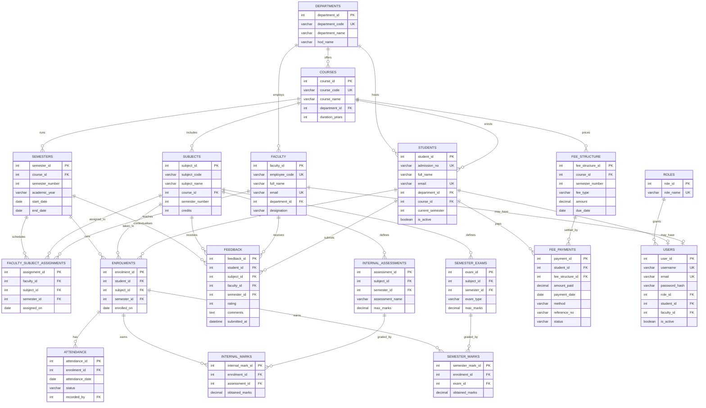

# GM University Management System — ER Diagram

> **Status: PLANNING.** This is a proposed model. It has not been reviewed or approved.
> **Do not create tables from this diagram yet.**

---

## 1. How to read this diagram

- `||--o{` means **one to zero-or-many** (one department has many courses).
- `||--||` means **one to exactly one**.
- `}o--o{` means **many to many** (resolved later with a junction table).
- The label on the line is the relationship verb.

This diagram shows entities and relationships. Columns are summarized; the full column list is in `DATA_DICTIONARY.md`.

---

## 2. Entity–relationship diagram

---

## 3. Entity summary

| Entity | What it represents | Why it exists |
|---|---|---|
| Department | An academic department | Groups courses, faculty, and students. |
| Course | A programme offered by a department | Groups semesters, subjects, and students. |
| Semester | A course term in an academic year | Anchors subjects, enrolments, and assignments. |
| Subject | A unit of study | The thing students are enrolled in and graded on. |
| Faculty | A teacher | Teaches subjects and receives feedback. |
| Student | A learner | The central person in the system. |
| Faculty–Subject Assignment | Who teaches what, when | Connects faculty to subjects and semesters. |
| Enrolment | A student taking a subject | The anchor for attendance and marks. |
| Attendance | Presence for one enrolment on one date | Tracks participation. |
| Internal Assessment | A component of internal marks | Defines the maximum and name. |
| Internal Mark | A student's score on a component | Stores internal performance. |
| Semester Exam | An end-of-term exam definition | Defines the exam and maximum. |
| Semester Mark | A student's exam score | Stores exam performance. |
| Fee Structure | The amount due for a course/semester | Defines what a student owes. |
| Fee Payment | A payment made by a student | Tracks money received. |
| Feedback | A student's rating and comment | Collects qualitative input. |
| Role | A permission group | Supports role-based access. |
| User | A login account | Connects a person to a role. |

---

## 4. Open design questions

These are intentionally unresolved in the planning phase:

1. Is a semester a global term or a per-course term? The diagram assumes per-course.
2. Should `students.current_semester` be a number or a foreign key to `semesters`? The diagram uses a number for simplicity.
3. Can a subject belong to more than one course? The diagram assumes one course.
4. Can a faculty member be assigned to the same subject in multiple semesters? The diagram allows it through `semester_id`.
5. Should feedback be anonymous? The diagram links it to a student.
6. Should users be linked to both students and faculty, or use a single person table? The diagram allows optional links.
7. What is the exact delete policy for historical records? The diagram does not fix it.
8. Is `fee_structure` per course/semester or per student? The diagram assumes per course/semester.

These questions are answered in Stage 3 after user review.

---

## 5. Approval

| Item | Status |
|---|---|
| Draft created | Yes (Stage 0 planning) |
| Reviewed by user | No |
| Approved for implementation | No |

Until approved, the schema remains **PLANNING**.
