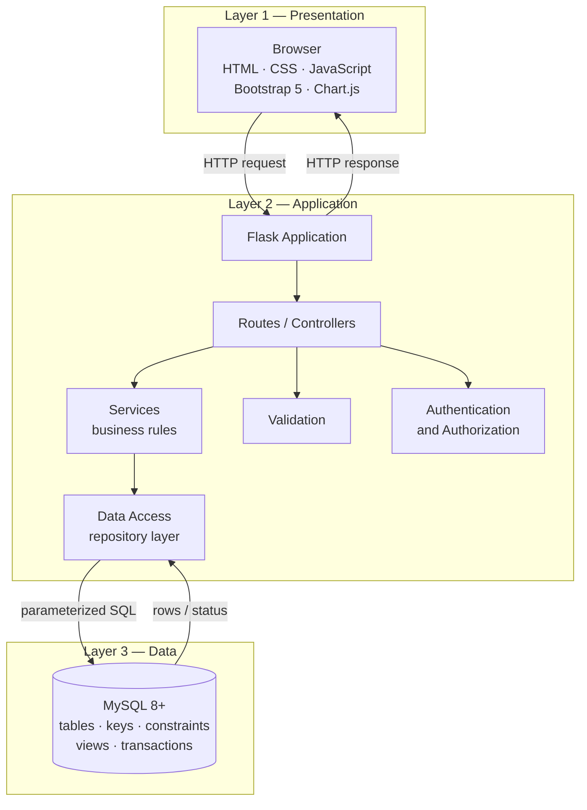
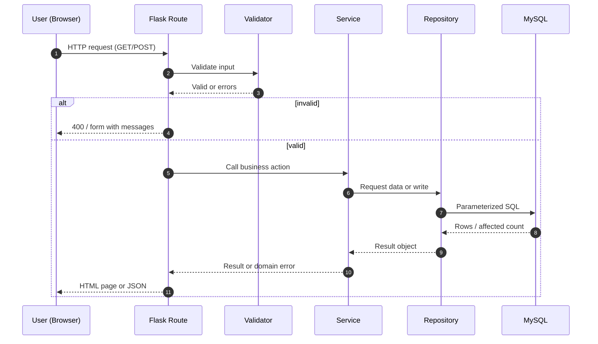
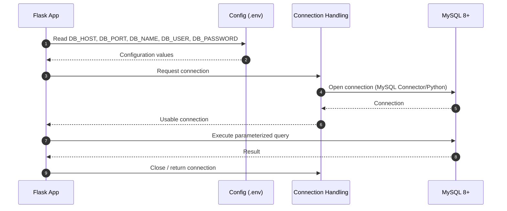
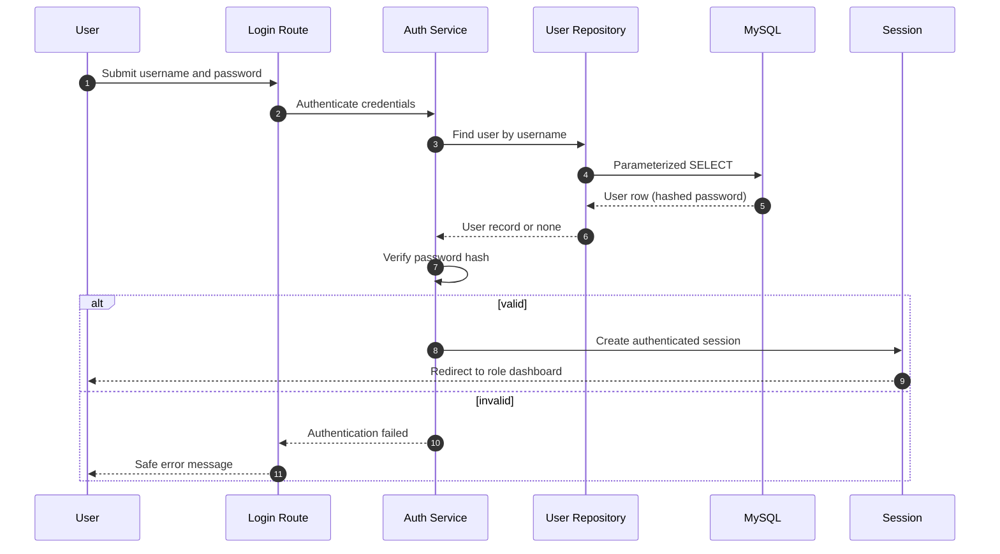
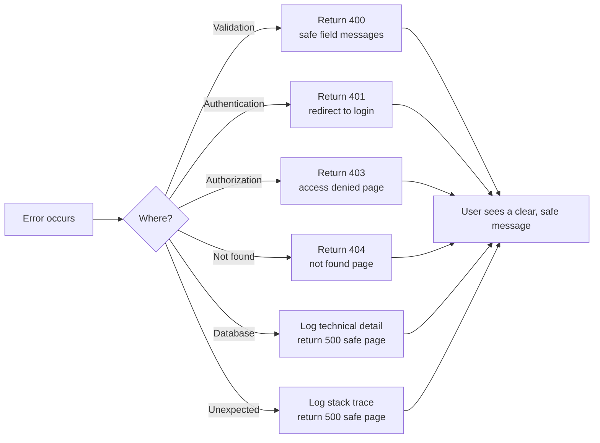
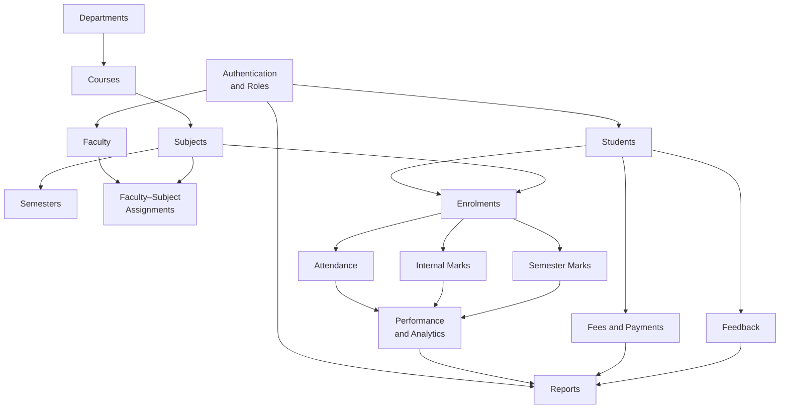

# NEXUS — System Architecture

> **Status:** Approved architecture (ADR-002). Planning only; no implementation exists.
> **Implementation status:** None. No application code exists yet.
> **Change rule:** Any structural change requires an ADR in `docs/decisions/`.

---

## 1. Overview

NEXUS uses a **three-tier web application architecture**. Each tier has one job, and communication flows in one direction for requests and back for responses.

### Why three tiers?

- The browser cannot reach the database, so credentials and SQL stay on the server.
- Business rules live in one place instead of being duplicated in pages.
- The database can be tested independently of the interface.
- Each layer can be replaced or improved without rewriting the others.

---

## 2. Layer 1 — Presentation

**Technology:** HTML5, CSS3, JavaScript, Bootstrap 5 where appropriate, Chart.js.

**Responsibilities:**

- Render pages and forms.
- Collect user input.
- Show validation feedback quickly for usability.
- Request data from the application layer over HTTP.
- Display charts and reports.
- Handle light and dark themes.

**Must not:**

- Connect to MySQL.
- Hold database credentials.
- Contain business rules that the server depends on.
- Trust user input.

**Key folders:**

- `frontend/templates/` — Jinja2 pages.
- `frontend/static/css/` — stylesheets and design tokens.
- `frontend/static/js/` — behaviour and charts.
- `frontend/static/img/` — images and icons.

---

## 3. Layer 2 — Application

**Technology:** Python, Flask, MySQL Connector/Python.

**Responsibilities:**

- Define routes and HTTP methods.
- Validate and sanitize input.
- Authenticate users and enforce roles.
- Apply business rules.
- Manage database connections and transactions.
- Return HTML pages or JSON responses.
- Log errors safely.

**Internal structure:**

| Part | Job |
|---|---|
| Routes / controllers | Receive the request, call the right service, return a response. |
| Services | Business logic and rules. |
| Validation | Server-side checks and safe error messages. |
| Authentication | Login, logout, session handling. |
| Authorization | Role checks and permission gates. |
| Repositories / data access | Parameterized SQL, connection handling, transactions. |

**Key folders:**

- `backend/app/__init__.py` — application factory.
- `backend/app/routes/` — blueprints.
- `backend/app/services/` — business logic.
- `backend/app/repositories/` — SQL and data access.
- `backend/app/models/` — plain data structures (not an ORM unless approved).
- `backend/app/validators/` — input validation.
- `backend/app/auth/` — authentication and authorization.
- `backend/config.py` — configuration from environment variables.
- `backend/requirements.txt` — Python dependencies.

These paths are the recommended layout. They are created only when the relevant stage begins.

---

## 4. Layer 3 — Data

**Technology:** MySQL 8+.

**Responsibilities:**

- Store normalized relational data.
- Enforce integrity with primary keys, foreign keys, and constraints.
- Provide views for reporting.
- Support transactions with `COMMIT`, `ROLLBACK`, and `SAVEPOINT`.
- Enforce access control with `GRANT` and `REVOKE`.
- Keep data consistent under concurrent access.

**Key folders:**

- `database/schema/` — DDL for tables.
- `database/migrations/` — numbered, repeatable schema changes.
- `database/seeds/` — fake sample data.
- `database/views/` — reporting views.
- `database/procedures/` — stored procedures.
- `database/triggers/` — triggers.
- `database/documentation/` — ER diagram, design, normalization, data dictionary.

**Rules:**

- InnoDB and `utf8mb4`.
- Every table has a primary key.
- Foreign keys have explicit `ON DELETE` / `ON UPDATE`.
- Money uses `DECIMAL`, never `FLOAT`.
- The schema is marked **PLANNING** until reviewed.
- No table is created in Stage 0.

---

## 5. Request–response flow

**Rules:**

- A route does not contain raw SQL.
- A service does not build HTML.
- A repository does not decide business rules.
- Every layer returns a clear result or a safe error.

---

## 6. Database connection flow

**Rules:**

- Credentials come from environment variables, never source code.
- Connections are always closed, even on error.
- Multi-step writes use a transaction.
- Errors are logged without exposing credentials or SQL details to the user.

A connection pool may be added later if performance requires it. It is not assumed now.

---

## 7. Authentication flow

**Rules:**

- Passwords are stored as hashes, never plaintext.
- Login errors do not reveal whether the username exists.
- Sessions use secure cookie flags.
- Role checks happen on the server for every protected route.
- Logout clears the session.

The exact role model and user table design are confirmed in a later stage.

---

## 8. Error-handling flow

**Rules:**

- Users see safe, helpful messages.
- Technical details go to server logs.
- No stack traces, SQL statements, or credentials reach the browser.
- Every error path is tested.

---

## 9. Module interaction

The exact keys and cardinalities are defined in the database design documents. This diagram shows functional dependencies, not final table columns.

---

## 10. Recommended folder responsibilities

| Path | Responsibility | Created in |
|---|---|---|
| `frontend/templates/` | Jinja2 pages | Stage 2 |
| `frontend/static/css/` | Design tokens and styles | Stage 1–2 |
| `frontend/static/js/` | Behaviour and charts | Stage 2 |
| `backend/app/routes/` | HTTP endpoints | Stage 4 |
| `backend/app/services/` | Business logic | Stage 4–5 |
| `backend/app/repositories/` | SQL and data access | Stage 4 |
| `backend/app/models/` | Data structures | Stage 4 |
| `backend/app/validators/` | Input validation | Stage 4 |
| `backend/app/auth/` | Login and roles | Stage 4 |
| `backend/config.py` | Environment configuration | Stage 4 |
| `database/schema/` | Table DDL | Stage 3 |
| `database/migrations/` | Versioned changes | Stage 3 |
| `database/seeds/` | Fake sample data | Stage 3 |
| `database/views/` | Reporting views | Stage 6 |
| `database/procedures/` | Stored procedures | Stage 6 |
| `database/triggers/` | Triggers | Stage 6 |
| `tests/` | Automated tests | Stage 7 |
| `scripts/` | Setup and utility scripts | Stage 4+ |
| `docs/` | Deep documentation | All stages |
| `reports/` | Generated report assets | Stage 9 |

---

## 11. Architectural decisions already made

- Three-tier architecture — see `docs/decisions/ADR-002-three-tier-architecture.md`.
- MySQL 8+ as the database — see `docs/decisions/ADR-003-mysql-database-selection.md`.
- Flask with MySQL Connector/Python — see `docs/decisions/ADR-001-technology-stack.md`.
- Design philosophy — see `docs/decisions/ADR-004-frontend-design-philosophy.md`.
- Database access strategy — see `docs/decisions/ADR-005-database-access-strategy.md`.

Anything not recorded there is not approved architecture.
